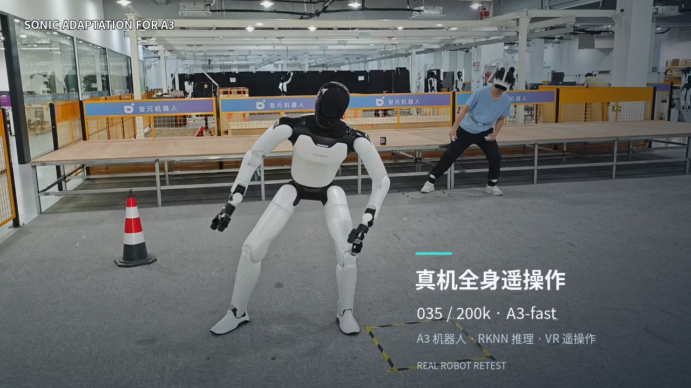

# SONIC adaption for A3

[](https://agibottech.github.io/sonic_for_a3/)

**035 / 200k · A3-fast RKNN · Real-robot teleoperation** — [Watch the video (3:32)](https://agibottech.github.io/sonic_for_a3/).

[Explore the 024 / 035 training curves](https://agibottech.github.io/sonic_for_a3/training/) — searchable, interactive TensorBoard scalar snapshots.

> **Note — Real-robot safety:** We strongly recommend using a safety gantry / fall-arrest harness and appropriate protective measures during real-robot teleoperation. These checkpoints do **not** guarantee stable tracking of every motion; unexpected behavior, loss of balance, and falls can occur. **Before playing any motion or deploying your own teleoperation integration on the real robot, first validate it in MuJoCo.** MuJoCo simulation cannot fully represent real-robot behavior, and successful simulation does not guarantee safe hardware execution. Keep physical safety protection in place, maintain a safe distance from the robot, and prioritize the personal safety of operators and bystanders.

This project builds on
[GR00T-WholeBodyControl / SONIC](https://nvlabs.github.io/GR00T-WholeBodyControl/).
We sincerely thank the GEAR team for their amazing and solid work, their
comprehensive open-source release, and their thorough documentation, which
made this A3 adaptation possible.

This repository provides the SONIC whole-body-control workflow for **AgiBot A3/A3U**,
including the 035 and 089 training contracts, MuJoCo simulation, deployment,
and real-time XR retargeting.

Start with the [end-to-end guide](docs/a3_training2sim2deploy.md). It provides
the authoritative path from A3 flat CSV data to training, sim2sim, ONNX/RKNN,
a staged deploy package, and the complete XR teleoperation workflow in simulation
and on the real robot.

The identifiers `035` and `089` are experiment labels only; they have no special
meaning and do not denote product versions, model generations, or hardware variants.

## News

- **[2026-10-30]** Released the **089 / 136k checkpoint** with improved
  sim-to-real performance, standalone
  [AimRT MuJoCo simulation](aimrt_mujoco_sim_a3/README.md), and a real-time
  XR retargeting teleoperation pipeline.
- **[2026-09-25]** Released the initial code and the **035 / 200k checkpoint**.

## Model card

| Model | Training step | Major improvement | Encoders | A3-fast reference | Artifacts |
| --- | ---: | --- | --- | --- | --- |
| [089](checkpoints/089_step136000/README.md) | 136,000 | 1. More stable upper body, more accurate wrist tracking and a larger workspace for manipulation.<br>2. Smoother walking with less stumbling and bouncing. | G1, A3-fast | 10 frames at 20 ms intervals | [Hugging Face](https://huggingface.co/sonic-for-a3/sonic/tree/main/089_step136000) |
| [035](checkpoints/035_step200000/README.md) | 200,000 |  | G1, A3-fast | 10 frames at 20 ms intervals | [Hugging Face](https://huggingface.co/sonic-for-a3/sonic/tree/main/035_step200000) |

Both policies control 29 A3 joints at 50 Hz. PT files support training and
sim2sim; matching ONNX and RKNN files are used for deployment. Neither
checkpoint includes an SMPL encoder.

Download a specific release from the repository root:

```bash
python download_from_hf.py --model 089 --component pt onnx rknn
python download_from_hf.py --model 035 --component pt onnx rknn
```

## What is included

### 1. A3 training code adaptation

The release contains the complete A3 adaptation of the SONIC training workflow:
Hydra configurations, portable launchers, A3 URDF/MJCF assets, selected flat
CSV examples, and the A3-specific reward and observation contracts. The
[035 / 200k contract](checkpoints/035_step200000/README.md) uses a passive-foot
model; its PT is hosted on
[Hugging Face](https://huggingface.co/sonic-for-a3/sonic/tree/main/035_step200000).
The [089 / 136k contract](checkpoints/089_step136000/README.md) uses the later
rigid-foot collision model, self-contact rewards and dynamic ankle model. See
the [089 checkpoint directory](checkpoints/089_step136000/README.md) for its
artifact and availability details.

Although the 035 checkpoint was trained using the A3 URDF, its domain randomization
was specifically tuned to support both **A3 and A3 Ultra (A3U)**. The corresponding
models can therefore also run on A3 Ultra.

### 2. MuJoCo sim2sim

It includes MuJoCo sim2sim support with the closed-loop ankle/waist serial and
parallel joint solver, so the same policy interface can be exercised offline
against the A3 model before deployment.

### 3. High-performance C++ deployment on A3

The C++ deployment framework is designed for high-performance inference on A3.
It supports cross-compilation for the A3 RK3588S Rockchip board, including NPU
inference through RKNN, and a Drive Thor target for A3 Ultra through the Thor
runtime variant. **The Rockchip / RKNN deployment workflow also supports A3 Ultra
(A3U)**; A3 Ultra can use either the Rockchip deployment path or the Thor runtime
variant, depending on the target hardware.

Use the matching G1 and A3-fast ONNX/RKNN artifacts for the selected checkpoint.
The 035 step-200,000 artifacts are available from Hugging Face; for 089
step-136,000, follow the artifact preparation and package build steps in the
[end-to-end guide](docs/a3_training2sim2deploy.md).

### 4. Sim-to-real experience and implementation

The release includes tested sim-to-real training configurations for A3,
including domain randomization of actuator gains, joint friction and armature,
body mass, contact materials, joint offsets and external pushes. It also models
motor T–N curves and serial/parallel joint torque limits. The 089 configuration
adds actuator delay and a dynamic ankle model with randomized motor inertia.
See the checkpoint documentation for the [035](checkpoints/035_step200000/README.md)
and [089](checkpoints/089_step136000/README.md) training configurations.

## Current limitations

- The 035 and 089 checkpoints provide the **G1 encoder** and the **A3-fast
  encoder**. Neither provides an SMPL encoder or a teleoperation encoder.
- A3-fast is the low-latency deployment path: it uses the G1 encoder with a
  20 ms frame interval and exposes future frames through 180 ms. It is not a
  separate SMPL or teleoperation representation, so an upstream real-time
  retargeting module is still required. This release cannot directly run the
  original SONIC SMPL teleoperation chain or the `MotionBricks + VR3 point`
  hybrid chain.
- The current policy is intended for motions whose ground contact stays on both
  feet or in which one foot is lifted from the ground. It does not currently
  support kneeling, lying down, standing back up, or other motions that add
  contact between the ground and additional limbs.
- Fast running and other highly dynamic motions are outside the current
  capability and validation scope.

## Future TODO

- [ ] Publish a checkpoint with SMPL and teleoperation encoders.
- [ ] Improve sim-to-real transfer and expand abilities, including ground-based motions.
- [ ] Add a detailed deployment-on-Thor tutorial for the A3 Ultra Thor runtime.

## Licensing and asset provenance

Source code and the **035 step-200,000 and 089 step-136,000 model artifacts**
(PT, ONNX and RKNN) are licensed under the [Apache License 2.0](LICENSE). Third-party
components and data retain their respective licenses and notices; see
[Third-party and asset notices](docs/THIRD_PARTY_NOTICES.md).  The A3 robot description is a modified derivative of the
public [AgibotTech/A3-A3U-robot-model](https://github.com/AgibotTech/A3-A3U-robot-model)
and is subject to its [Mulan Permissive Software License v2](https://github.com/AgibotTech/A3-A3U-robot-model/blob/main/LICENSE.txt)
and retained notices.

Real robots can cause injury or damage.  Treat the deploy package as a
development reference: first run receive-only and simulator checks, verify
joint mapping and safety limits for the target robot, and use an operator-
controlled staged bring-up. The authoritative MDU service takeover, no-command
probe, and `taskset -c 4-5` launch sequence is §6.1 of the
[end-to-end guide](docs/a3_training2sim2deploy.md).
